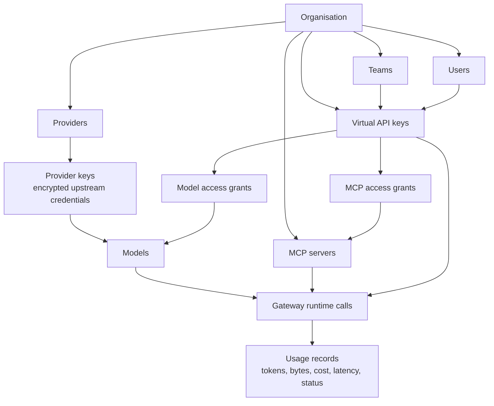
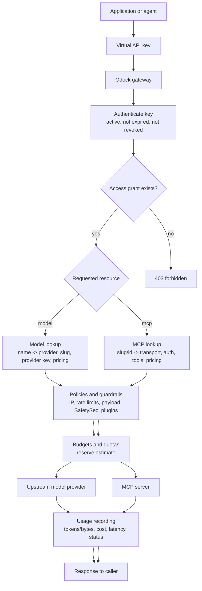

# Models & MCP

Models and MCP servers are the resources applications call through Odock.

A model is an LLM, embedding, image, audio, or similar AI model backed by an upstream provider. An MCP server is a tool server exposed through the Model Context Protocol and governed by Odock before traffic reaches the tool runtime.

## Why This Matters

Without a gateway, each application needs its own provider credentials, tool endpoints, pricing rules, and policy logic. That is hard to audit and risky to change.

With Odock:

- Applications call one gateway with a virtual API key.
- Provider secrets stay in Odock, not in application code.
- Each virtual API key gets explicit model and MCP access grants.
- Policies, budgets, quotas, routing, guardrails, and usage records are applied consistently.
- Usage records show caller, resource, provider or MCP server, cost, and status.

For the API key concept, see [Virtual API Keys](/docs/management/virtual-api-keys). For policy and safety behavior, see [Guardrails](/docs/security-and-guardrails/guardrails). For cost controls, see [Budgets](/docs/management/budgets) and [Quotas](/docs/management/quotas).

## Core Hierarchy

Models, MCP servers, and API keys belong to an organisation. API keys can be organisation-, team-, or user-scoped. Runtime access is not inherited from team or organisation membership. Grant access directly to the API key that makes the gateway call.

Rule: create or import the resource, configure cost and governance, then grant access to the virtual API key that uses it.

## Provider, Model, MCP, API Key

These concepts are related, but not interchangeable.

| Concept | What it is | Used by the gateway for |
| --- | --- | --- |
| Provider | The upstream AI service connection, such as OpenAI, Anthropic, Google, Azure OpenAI, vLLM, Mistral, or a custom-compatible provider. | Selecting the upstream API family, base URL, timeout, and provider implementation. |
| Provider key | The upstream secret for a provider. | Authenticating from Odock to the upstream provider. It is not given to applications. |
| Model | The organisation model record that clients request by name. | Resolving the requested model to a provider, upstream slug, provider key, capabilities, pricing, and policies. |
| MCP server | A governed tool server exposed through `/v1/mcp/{slug}` or `/v1/mcp/{id}`. | Resolving tool traffic to a transport, auth config, tool allow/block rules, pricing, and policies. |
| Virtual API key | The Odock credential used by applications. | Authenticating the caller, applying scope, checking model/MCP grants, attributing usage, and enforcing budgets or quotas. |

## Scoped Access

There are two forms of scope you will see in the UI.

A virtual API key has an owner scope:

- `ORGANISATION`: for shared services used across the organisation.
- `TEAM`: for a team-owned app, workflow, or agent.
- `USER`: for personal experiments or user-owned automation.

A model or MCP server also has resource-level configuration:

- Models belong to an organisation and can have policies and pricing.
- MCP servers belong to an organisation and may also be narrowed with a Team Scope or API Key Scope.
- Access grants decide which virtual API keys can call the resource at runtime.

For most workflows, use access grants as the runtime boundary. Use team or API-key scoping on MCP servers only when the server itself should be visible or usable in a narrower context.

## Runtime Flow

When an application calls the gateway, Odock combines resource configuration with API key context.

For LLM traffic, Odock resolves the requested model name to a model record. That record defines the provider, upstream slug, provider key, pricing, and policies.

For MCP traffic, Odock resolves the slug or id, checks `MCP Access`, applies tool rules and semantic filters, proxies to the configured transport, and records method, tool name, bytes, latency, and cost.

## What Users Configure

Use the organisation UI to:

- **Providers**: activate and configure upstream provider connections.
- **Provider detail**: add provider keys and create models bound to that provider.
- **Models & MCP Servers**: list and open configured models.
- **MCP Servers**: list and open configured MCP servers.
- **API Keys**: grant model and MCP access, configure key-level policies, routing, budgets, quotas, and review usage.
- **Usage Records**: inspect model and MCP traffic.
- **AI Playground**: test configured models from the UI before using them in applications.

## Recommended Setup Order

Use this order for production setup.

<Steps>

<Step>
Activate or create the provider.
</Step>

<Step>
Add the provider key.
</Step>

<Step>
Add models manually or from the [Model Catalog](/docs/models-and-mcp/model-catalog).
</Step>

<Step>
Review or edit model pricing and policies.
</Step>

<Step>
Add MCP servers manually or from the trusted MCP catalog.
</Step>

<Step>
Review MCP transport, auth, governance, pricing, and policies.
</Step>

<Step>
Create or open the virtual API key that will call the resources.
</Step>

<Step>
Grant model access and MCP access.
</Step>

<Step>
Add budgets, quotas, or routing policies if needed.
</Step>

<Step>
Test through the AI Playground or through a gateway request.
</Step>

<Step>
Review usage records for provider, model, MCP server, tokens, bytes, cost, latency, status, and routing metadata.
</Step>

</Steps>

## Runtime Configuration Refresh

Odock stores configuration in Postgres. The gateway caches common runtime data in Redis and short-lived in-process caches. When you edit a runtime-sensitive resource, cache invalidation tells gateway instances to reload it on the next matching request.

Changes to model pricing, provider keys, model access, MCP access, API key revocation, or MCP server configuration take effect without a gateway restart.

For the larger management/runtime architecture, see [Architecture](/docs/getting-started/architecture).

## Where To Go Next

For a new setup, read these pages in order:

- [Providers](/docs/models-and-mcp/providers): connect upstream AI providers and provider keys.
- [Model Catalog](/docs/models-and-mcp/model-catalog): browse the platform-curated Odock Catalog (available automatically) and your own provider-synced model list before creating model records.
- [Models](/docs/models-and-mcp/models): create model records, configure capabilities, pricing, policies, and access.
- [Add a variant model](/docs/models-and-mcp/models/add-variant-model): create a client or project-specific Odock model name, such as `gpt-4.1-clientA`, that points to an existing upstream slug.
- [MCP Servers](/docs/models-and-mcp/mcp-servers): add tool servers, configure transport/auth/governance, pricing, and access.
- [Endpoints](/docs/models-and-mcp/endpoints): understand how applications call models and MCP servers through the gateway.
