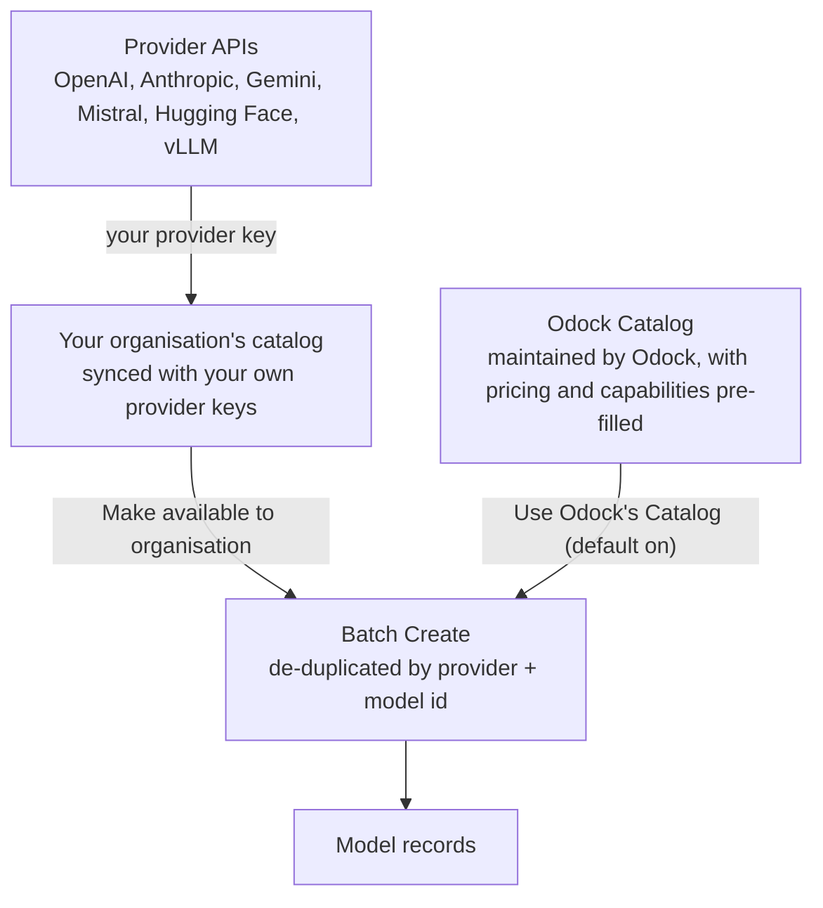

# Model Catalog

Creating a model manually means entering its upstream slug, context window, and pricing yourself. The Model Catalog removes that work. It stores normalized model metadata: type, capabilities, context window, and, when available, pricing. Sync catalog entries from provider APIs, then create model records from them.

## Two Sources, One Catalog

Your organisation has its own catalog at `/{organisation}/models` → **Model Catalog**. Organisation Admins can sync and manage it. Other roles do not see this tab. When you sync a provider, choose the source:

| Source | Populated from |
| --- | --- |
| Your provider's live model list | Your own provider account, using your organisation's provider key |
| Odock Catalog | A reference list Odock maintains for that provider, with pricing and capability metadata already filled in |

Your organisation catalog feeds **Batch Create** when adding models. See [Add models from the catalog](/docs/models-and-mcp/models/add-models-from-catalog).

<Callout type="tip">
For most providers, do not sync from the Odock Catalog. Odock Catalog models appear in **Batch Create** automatically, per provider, through **Use Odock's Catalog**. Sync from Odock Catalog only when you need an editable copy or turned that setting off. See [Automatic Odock Catalog Availability](/docs/models-and-mcp/model-catalog/automatic-availability).
</Callout>

## Automatic Availability, No Duplicates

Any Odock Catalog model approved for all organisations appears directly in **Batch Create** for a matching active provider. No sync or activation is required. This is on by default and can be disabled per provider in **Settings**.

Earlier versions required syncing an Odock Catalog model into your organisation catalog and marking it available. If the model was already automatic, **Batch Create** showed two entries. Odock now de-duplicates by provider and model id, so the same model is not shown twice by accident.

To keep two entries for the same upstream model, for example default Odock pricing plus a custom-priced copy, choose **Replace** or **Keep both** when making the synced entry available. See [Automatic Odock Catalog Availability](/docs/models-and-mcp/model-catalog/automatic-availability#resolving-a-duplicate). This is separate from creating a [variant model](/docs/models-and-mcp/models/add-variant-model), which happens later when catalog entries become model records.

## What A Catalog Entry Carries

| Field | Meaning |
| --- | --- |
| Model id | The upstream provider-native identifier sent as `model` |
| Display name | A human-readable label, when the provider supplies one |
| Type | Normalized classification: chat, embedding, image, audio, video, moderation, rerank, OCR, transcription, or TTS |
| Capabilities | Feature flags such as vision, reasoning, or tool use |
| Context window / max output tokens | Known limits, when the provider reports them |
| Pricing | Input/output cost, when the provider publishes it, or already filled in on the Odock Catalog |
| Availability | Whether the entry is available to your organisation in **Batch Create** — **Available** or **Hidden**. A synced entry deliberately kept alongside an Odock Catalog entry (see [Resolving a duplicate](/docs/models-and-mcp/model-catalog/automatic-availability#resolving-a-duplicate)) is also tagged **Alongside Odock** |

Not every provider exposes every field. Cloud providers rarely expose pricing through model-listing APIs, so you often set pricing after sync. Odock Catalog fills that gap for common models.

## Why Sync Instead Of Type It By Hand

- Syncing catches new provider models without tracking release notes.
- Capabilities and context window come from the provider, not guesses.
- Syncing from your provider account can find private or fine-tuned models only your key can see.
- Odock Catalog supplies pricing and capability metadata for common models.

## Section Guide

- [Automatic Odock Catalog Availability](/docs/models-and-mcp/model-catalog/automatic-availability): the per-provider setting and duplicate-resolution flow.
- [Syncing Into Your Organisation](/docs/models-and-mcp/model-catalog/sync-to-your-organisation): choose a source and sync entries.
- [Tutorials](/docs/models-and-mcp/model-catalog/tutorials): a step-by-step walkthrough.

Once models exist in your organisation's catalog, turn them into model records with [Add models from the catalog](/docs/models-and-mcp/models/add-models-from-catalog) or [Add models from a provider](/docs/models-and-mcp/providers/add-models-from-provider).
