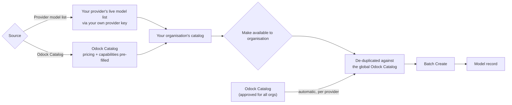

# Syncing Into Your Organisation

Your organisation catalog lives at `/{organisation}/models` → **Model Catalog**, next to **Models**. Organisation Admins use it to sync entries before turning them into model records.

<Callout type="tip">
Odock Catalog models approved for all organisations already appear in **Batch Create** per provider. Sync from **Odock Catalog** only if you turned that off or need an editable copy. Sync from **Provider model list** to find private or fine-tuned models. See [Automatic Odock Catalog Availability](/docs/models-and-mcp/model-catalog/automatic-availability).
</Callout>

## Two Sources, One Sync Flow

When syncing, choose the source:

| Source | What you get | Trade-off |
| --- | --- | --- |
| **Provider model list** | Live list from your provider account, using your organisation provider key. Includes private and fine-tuned models. | Usually lacks pricing or capability metadata; set it afterward. |
| **Odock Catalog** | Odock's maintained list for that provider type. | Includes pricing and capabilities, but only for models Odock tracks. |

<Steps>

<Step>
Open **Models** in your organisation, then the **Model Catalog** tab.
</Step>

<Step>
Select the provider in the sync bar and click **Sync latest**.

The dialog opens so you can choose a source and preview results before syncing.
</Step>

<Step>
Choose a source: **Provider model list** or **Odock Catalog**.

Switching sources reloads the preview and clears your selection. Choose the source first.
</Step>

<Step>
Review the preview, grouped into **New models** and **Already in your catalog**.

Selecting an existing catalog model updates it. Your pricing and capability edits are kept.
</Step>

<Step>
Search or scan the list, select the models you want, and click **Sync selected**.
</Step>

</Steps>

## Making A Synced Entry Available

Syncing adds entries to your organisation **catalog**. It does not make them selectable in **Batch Create**. Select the row and click **Make available to organisation**.

If the row matches an automatic Odock Catalog model by provider and model id, **Resolve duplicate models** asks you to **Replace** or **Keep both**. Rows with no match become available immediately. See [Resolving a duplicate](/docs/models-and-mcp/model-catalog/automatic-availability#resolving-a-duplicate).

## From Catalog Entry To Model Record

Making an entry available only adds it to **Batch Create**. It does not create a callable model record. Use **Batch Create** to create the record. See [Add models from the catalog](/docs/models-and-mcp/models/add-models-from-catalog).

## Choosing A Source In Practice

| Situation | Use |
| --- | --- |
| You want a fine-tuned or private model only your account can see | Provider model list |
| You want a standard model with correct default pricing and no custom changes | Nothing; it is already automatic. See [Automatic Odock Catalog Availability](/docs/models-and-mcp/model-catalog/automatic-availability) |
| You want your own editable copy of an Odock Catalog model, e.g. for client-specific pricing | Odock Catalog, then **Keep both** when making it available |
| The Odock Catalog does not yet list a model you need | Provider model list, then set pricing yourself in **Models** |
| Use Odock's Catalog is off for this provider | Odock Catalog, so you have a route to Odock's curated metadata without the automatic setting |

## Continue With

- [Automatic Odock Catalog Availability](/docs/models-and-mcp/model-catalog/automatic-availability) — the setting that makes syncing unnecessary for most models, and the duplicate-resolution flow.
- [Add models from the catalog](/docs/models-and-mcp/models/add-models-from-catalog) — turning a synced catalog entry into a callable model.
- [Tutorials](/docs/models-and-mcp/model-catalog/tutorials) for a full walkthrough.
