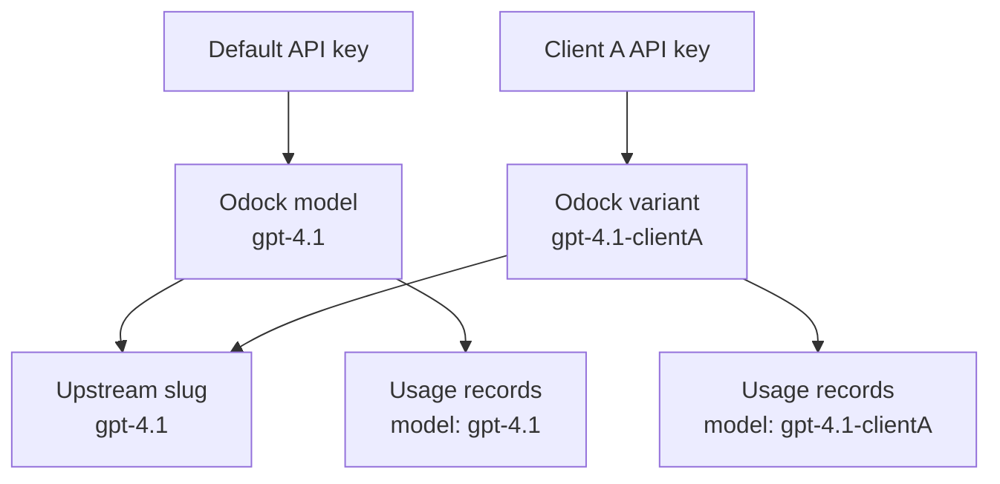

# Add a variant model

A variant model is another Odock model record for the same upstream provider slug, under a different Odock model name.

Example: create `gpt-4.1-clientA` as the Odock model name while keeping `gpt-4.1` as the upstream slug. Client A calls `gpt-4.1-clientA`; Odock forwards to upstream `gpt-4.1`.

## Why Use A Variant Model

Use a variant when different teams, clients, projects, or environments need different governance for the same upstream model.

Common reasons include:

- **Client-specific naming**: expose `gpt-4.1-clientA` without changing the upstream slug.
- **Different pricing**: apply client, internal, discount, or project pricing while another record keeps defaults.
- **Different policies**: set stricter rate limits, IP rules, or payload limits for one project.
- **Separate access grants**: give one API key access to `gpt-4.1-clientA` without granting access to the default `gpt-4.1` model record.
- **Cleaner usage reporting**: show the client, project, or workload in usage records.
- **Migration safety**: later point a stable project model name to a new upstream slug without changing application code.



## How It Works

Applications send the model **Name** to Odock. Odock sends the model **Slug** upstream.

For a variant model:

| Field | Example |
| --- | --- |
| Name | `gpt-4.1-clientA` |
| Slug | `gpt-4.1` |
| Provider | Same provider as the original model |
| Provider Key | Same key or a different provider key, depending on your setup |
| Pricing | Default pricing or client/project-specific pricing |
| Policies | Default policies or variant-specific policies |

## Create A Variant From The Catalog

Batch Create blocks only duplicate **names**. Reusing the upstream slug is allowed. Create a variant in either way:

- Select a catalog card that already has a distinct name, such as an **Alongside Odock** entry. See [Automatic Odock Catalog Availability](/docs/models-and-mcp/model-catalog/automatic-availability#resolving-a-duplicate).
- If the catalog card name collides with an existing model, click **Add with different name** and keep the same upstream slug.

<Steps>

<Step>
Open the provider detail page for the provider that already has the base model.
</Step>

<Step>
In the **Models** section, click **Batch Create**.
</Step>

<Step>
Select the provider key.
</Step>

<Step>
Find the model with the upstream slug, such as `gpt-4.1`.
</Step>

<Step>
If the card name collides, click **Add with different name**. If the name is already distinct, select it directly.
</Step>

<Step>
Enter the new Odock model name, such as `gpt-4.1-clientA`.
</Step>

<Step>
Create the selected model.
</Step>

<Step>
Open the new model and adjust pricing, policies, and API key access for the client or project.
</Step>

</Steps>


## After Creating The Variant

After creating the variant, grant access only to the API keys that should use it. For a client or project variant, update the application's model setting:

```json
{
  "model": "gpt-4.1-clientA"
}
```

Then confirm usage records show the variant model name.
