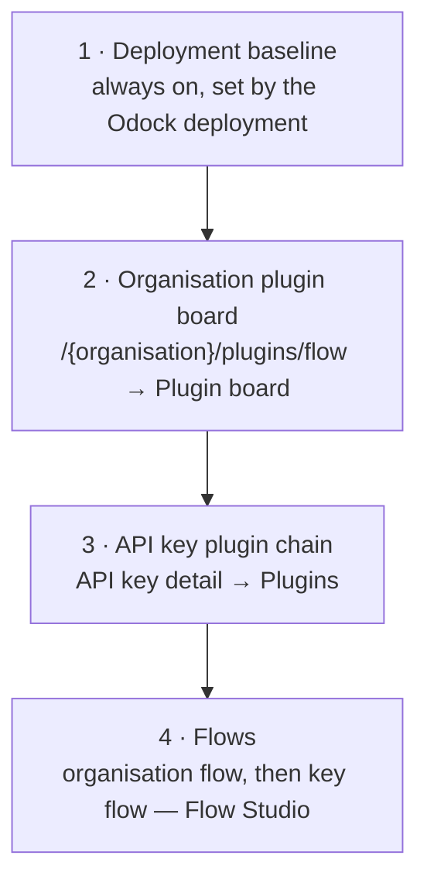

# Architecture

A plugin runs at a **gate**: a point in the request lifecycle where it has enough context to make a decision. Which gates a plugin uses, and where it sits relative to other plugins and flows, is configured — not hardcoded per plugin.

## Lifecycle Gates

| Gate | Context available | Common work |
| --- | --- | --- |
| Pre-route | Authenticated caller, resource, request metadata, request content — before model routing, budget, and safety checks | Eligibility checks, request enrichment, change the target model, custom headers, block |
| Pre-upstream | Same as pre-route, plus the routing outcome — immediately before the provider or MCP call | Last edits before the request leaves Odock, DLP before egress |
| Post-upstream | Upstream status, response metadata, response content, routing outcome | Response transformation, response DLP, analytics signals |
| Post-response | Request id, outcome, usage evidence, cost and latency — after the reply has already been sent | Audit export, webhook delivery, email, analytics export |

These are the same four gates [Flow Studio](/docs/plugins/flow-studio) uses. A plugin that needs the response cannot run at pre-route or pre-upstream — the response does not exist yet. A plugin doing background work should run at post-response, so it never delays the caller. See [Plugin Lifecycle](/docs/plugins/plugin-lifecycle) for a full walkthrough of each gate.

## Execution Layers

At each gate, up to four sources of behavior combine into one execution order:

| Layer | Scope | Configured at |
| --- | --- | --- |
| Deployment baseline | Every request | Deployment configuration |
| Organisation plugin board | Every API key in the organisation | [Plugin Board](/docs/plugins/plugin-board) |
| API key plugin chain | One API key | [API Key Plugin Chain](/docs/plugins/api-key-plugin-chain) |
| Flows | Organisation-wide or one API key | [Flow Studio](/docs/plugins/flow-studio) |

Layer order sets a default, but it is not the final word: within one gate, work is grouped into sequential, parallel, and async lanes, and **lane placement decides execution order, not layer position**. A parallel-lane plugin from layer 1 can run after a sequential-lane plugin from layer 3. See [Execution Lanes](/docs/plugins/execution-lanes) for the full model, and [Flow Studio: Execution Order](/docs/plugins/flow-studio/execution-order) for a worked example across all four layers.

## Capabilities

A plugin's configuration grants it capabilities. Depending on what it is granted, a plugin may:

- read selected request or response fields
- write request or response fields
- call an approved external endpoint
- block the request
- read or write plugin variables it stores per organisation or per binding

A plugin should receive only the capabilities its job requires. A plugin that only exports evidence should not have response-mutation permission; a plugin that only reads metadata should not have outbound network access.

## Configuration And Admin Variables

Most plugins take configuration: a webhook URL, a threshold, a template. Configuration lives at the level it applies to — organisation-wide on the plugin's profile page, or per-binding on the plugin board and the API key plugin chain.

Values a plugin needs to keep secret — an API token, a webhook signing secret — are stored as **admin variables**. They are encrypted in your browser before they reach Odock, using the same encryption path as [provider keys](/docs/models-and-mcp/providers/add-provider-key): the plaintext is never stored and cannot be read back from the UI, only replaced. The gateway decrypts a value only when it executes the plugin.

## Observability

Every plugin execution answers four questions:

- What did the plugin see?
- What did it do: allow, block, transform, or record?
- Which request id, API key, model, MCP server, or organisation was involved?
- Where can you inspect the outcome?

Plugin executions appear in [Usage Monitoring](/docs/observability/usage-records) per request, and in [Traffic Analytics: Plugins](/docs/observability/traffic-analytics/explore-plugins) aggregated across time. Configuration changes — activating, binding to a key, editing an admin variable — take effect on the next request; nothing requires a gateway restart.

## Relationship To Other Sections

| Area | Relationship |
| --- | --- |
| [Security & Guardrails](/docs/security-and-guardrails) | Plugins are one gate among several; standard policy, access, and rate limits stay in guardrails. |
| [SafetySec](/docs/security-and-guardrails/safetysec-engine) | SafetySec handles prompt and response safety. Plugins handle custom workflow and integrations. |
| [Flow Studio](/docs/plugins/flow-studio) | The same gates and lanes, authored as a graph instead of a fixed plugin. |
| [Models & MCP](/docs/models-and-mcp) | Plugins can use model or MCP context, but access grants still decide whether a key can call a resource. |
| [Budgets](/docs/management/budgets) and [Quotas](/docs/management/quotas) | Plugins can add evidence or integrations around cost, but spend and usage ceilings belong to budgets and quotas. |
