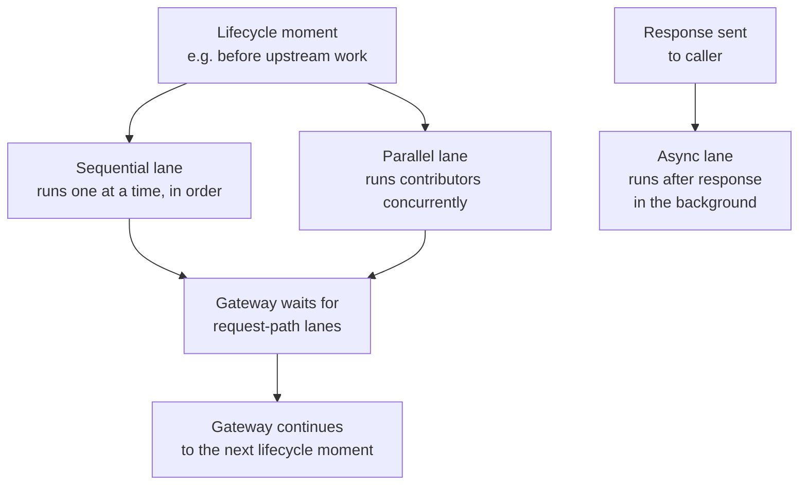
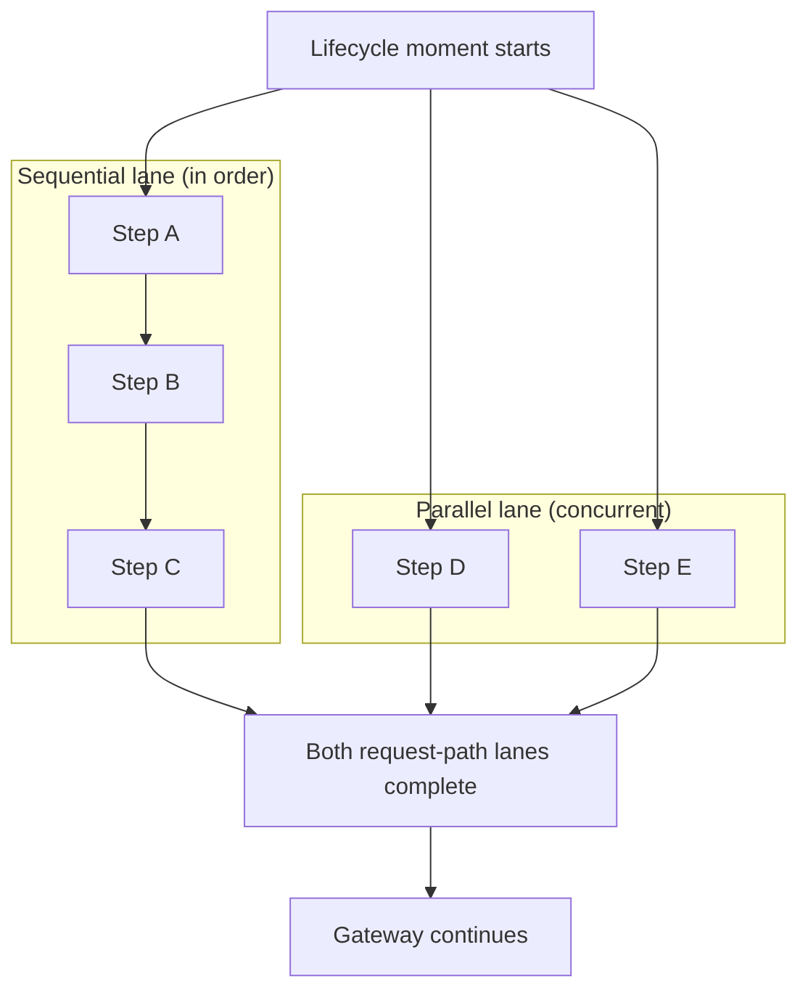

# Execution Lanes

A single lifecycle moment, such as before upstream work, can include several plugins and one active flow. Odock groups them into **lanes** so operators can reason about order, blocking, and latency.

This page covers lanes. For lifecycle moments, see [Plugin Lifecycle](/docs/plugins/plugin-lifecycle). For flows, see [Flow Studio: Execution Order](/docs/plugins/flow-studio/execution-order).

## Why Lanes Exist

Not every plugin blocks the caller or depends on previous work. A single strict queue would make independent read-only work pay unnecessary latency.

Odock splits lifecycle work into request-path lanes and an async lane:

| Lane | Runs | Can it block the request? | Typical use |
| --- | --- | --- | --- |
| Sequential | One contributor at a time, in configured order | Yes | Mutations, blocking, or work that must run before the next step |
| Parallel | All contributors concurrently, starting at the same lifecycle moment as the sequential lane | Yes, through the lane outcome; it does not stop other parallel work from starting | Independent checks and evidence that can run beside ordered work |
| Async | After the response is sent (after response/evidence moment only) | No | Audit export, webhooks, email, analytics, and other background side effects |

## The Rule That Matters: Lane Placement Controls Execution

Within one lifecycle moment, lane placement decides how a contributor runs. List position does not move work between lanes.

- Sequential-lane contributors run one after another, in order.
- Parallel-lane contributors start at the same lifecycle moment and run concurrently with each other and with the sequential lane.
- The gateway waits for request-path lanes to finish before moving to the next lifecycle moment, unless a blocking decision stops the request.
- The async lane never blocks anything. It starts only after the response has left, so nothing in the request path can depend on it.

All sources use these lanes: organisation plugin board, API key plugin chain, organisation flow, and key flow. Configure lane assignment per contributor. A plugin can declare itself parallel-safe, and an operator can still force strict order. Flows run in the sequential lane because graphs can branch, loop, and mutate state. A flow's after-response graph defaults to async because that phase is background work.

## Aborting From Each Lane

| Lane | If a contributor blocks the request |
| --- | --- |
| Sequential | The request stops after the blocking decision is applied. Later sequential contributors do not run. Parallel work for the same moment may already be running. |
| Parallel | The request stops once the parallel lane reports a blocking outcome. Because contributors run concurrently, other parallel work for the same moment may already have started. |
| Async | Blocking has no effect. The response was already delivered before this lane started. |

## Performance: Why The Parallel Lane Runs Concurrently

Plugins that only observe or emit evidence do not need to wait on each other or on ordered mutations. Running them concurrently keeps added latency close to the slowest request-path contributor instead of the sum of all contributors. This matters when several independent plugins share a lifecycle moment, such as audit logging, analytics, and partner integrations.

<Callout type="tip">
If [Traffic Analytics: Plugins](/docs/observability/traffic-analytics/explore-plugins) shows latency and several plugins share a lifecycle moment, check whether read-only work is in the sequential lane. Move it to the parallel lane or mark it parallel-safe when it can run beside ordered work.
</Callout>

## Choosing A Lane

| Question | Answer | Lane |
| --- | --- | --- |
| Does it need to run before another contributor sees the result? | Yes | Sequential |
| Can it change or block the request or response? | Yes | Sequential |
| Does it only observe or emit evidence, independent of other contributors? | Yes | Parallel |
| Should the caller wait for it at all? | No, and it runs after the response/evidence moment | Async |

## Relationship To Other Sections

- [Plugin Lifecycle](/docs/plugins/plugin-lifecycle) — the four lifecycle moments lanes apply within.
- [Architecture](/docs/plugins/architecture) — the public architecture model lanes fit into.
- [Flow Studio](/docs/plugins/flow-studio) — the automation layer that always runs in the sequential lane (or async, for after-response graphs), and how it combines with plugin lanes.
- [Traffic Analytics: Plugins](/docs/observability/traffic-analytics/explore-plugins) — where to observe plugin time and health per lane in practice.
