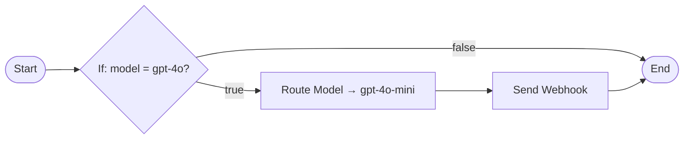

# Building Blocks

A flow graph uses **nodes** connected by **edges**. Every graph starts at one `Start` node and runs edge by edge until each branch reaches an `End`, dead end, or `Abort`. The palette shows only nodes valid for the current phase.

## Control

| Node | Purpose |
| --- | --- |
| Start | The phase entry point. Placed automatically; exactly one per non-empty phase. |
| End | Hands the request back to the gateway to continue to the next stage. |
| Abort | Blocks the request with a status code and message. Not available post-response because the reply already left. |

## Logic

| Node | Purpose |
| --- | --- |
| If | Branches on one or more conditions (`equals`, `not equals`, `greater/less than`, `contains`, `exists`, `matches`, `in`), combined with AND/OR. Exposes `true`/`false` outputs. |
| Switch | Multi-way branch on one value, with a case per expected value and a `default` output. |
| Loop | Iterates over a list (for example, each message in a conversation), running its body once per item. Exposes `body` and `done` outputs. |
| Parallel | Runs branches concurrently and joins them before continuing. This is separate from [Execution Lanes](/docs/plugins/execution-lanes). |
| Wait | Pauses the graph for a bounded delay. |

## Data

| Node | Purpose |
| --- | --- |
| Set Variables | Assigns one or more flow variables for later nodes to read. |
| Template | Renders a text template (mixing static text and expressions) into a variable. |
| Transform | Sets, copies, or deletes fields on the request, response, or flow variables in one step. |

## Request (Pre-route, Pre-upstream)

| Node | Purpose |
| --- | --- |
| Get Request Value | Reads a field from the request into a variable. |
| Set Request Value | Writes into the request body, model, or metadata. |
| Set Request Headers | Adds or removes headers sent upstream. |
| Route Model | Rewrites the target model for tiered or conditional routing. |

## Response (Post-upstream; reading is also available at Post-response)

| Node | Purpose |
| --- | --- |
| Get Response Value | Reads a field from the upstream response into a variable. |
| Set Response Value | Writes into the response body, status, or metadata before the caller sees it. |
| Set Response Headers | Adds or removes headers on the reply. |

## Integrations

| Node | Purpose |
| --- | --- |
| HTTP Request | Calls an external endpoint and exposes status, body, headers, and success flag. Failures can follow a separate `error` output. |
| Send Webhook | Sends fire-and-forget JSON to a URL. It never blocks the request, even on failure. |

## Context, Plugins & Utility

| Node | Purpose |
| --- | --- |
| Organisation Lookup | Loads details about the requesting organisation for use later in the graph. |
| Run Plugin | Invokes an already activated marketplace or built-in plugin with its normal configuration. If it aborts, the flow and request abort. |
| Log | Writes a structured gateway log line for build and debug work. |
| Note | A text annotation on the canvas — has no runtime effect. |

## Expressions

Fields can reference live request, response, and flow state with `{{double-brace}}` expressions. A field that is exactly one expression keeps the native type. An expression mixed into text renders as a string.

| Reference | Resolves to |
| --- | --- |
| `{{request.body...}}` | The parsed request body, e.g. `request.body.messages.0.content` |
| `{{request.model}}`, `{{request.path}}`, `{{request.method}}` | Routing fields for the current request |
| `{{request.headers.x-team}}` | A request header |
| `{{request.organisation_id}}`, `{{request.api_key_id}}`, `{{request.metadata...}}` | Caller and context identifiers |
| `{{response.body...}}`, `{{response.status}}`, `{{response.headers...}}` | Available in post-upstream and post-response phases only |
| `{{vars.name}}` | A flow variable set earlier in the same run |
| `{{nodes.<id>.<field>}}` | An earlier node's output, e.g. `nodes.lookup.body.team` |
| `{{item}}`, `{{index}}` | The current element and position inside a Loop body |
| `{{phase}}`, `{{now}}` | The current phase name and current timestamp |

## Building Limits

Flows run in the live request path. Every graph uses these limits:

| Limit | Bound |
| --- | --- |
| Nodes per phase | 150 |
| Edges per phase | 400 |
| Node executions per run | 2,000 |
| Walk depth | 64 |
| Loop iterations | 500 |
| Parallel branches | 8 |
| Wait duration | 2 seconds in request-blocking phases, 10 seconds in post-response |
| HTTP Request timeout | 30 seconds, 1 MiB response, 5 redirects |
| HTTP Request destinations | Private and loopback addresses are refused by default, closing off internal network access from a flow's outbound calls |

<Callout type="info">
A flow that fails validation or hits an unexpected load-time error is skipped for that request. The gateway fails open on broken flows. See [Testing & Verification](/docs/plugins/flow-studio/testing-and-verification).
</Callout>

## Node Errors vs. Aborts

A node error, such as an HTTP Request timeout without an `error` output, does not stop the request by default. The failing branch stops and the rest of the graph continues. You can switch a flow to treat node errors as hard stops, matching **Abort** behavior. Use strict mode for load-bearing steps, such as required enrichment. Keep the default for best-effort steps, such as optional notifications.
