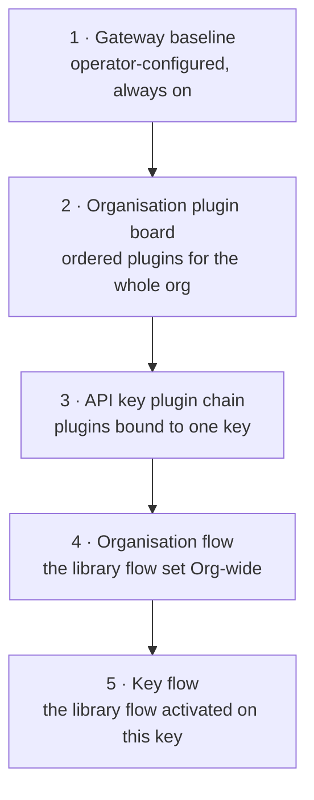
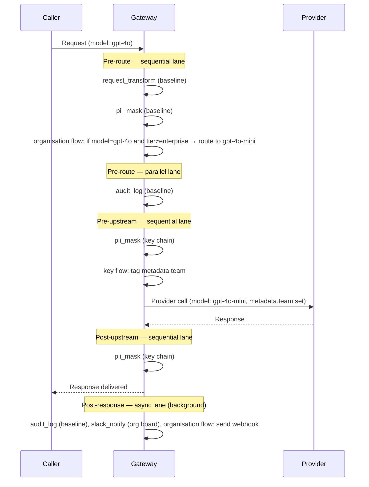

# Execution Order

At any lifecycle phase, up to five behavior sources can be active. Flow Studio adds two flow layers to the existing plugin sources. All five use the same [Execution Lanes](/docs/plugins/execution-lanes) model.

## The Five Layers

| Layer | Scope | Where it is configured |
| --- | --- | --- |
| 1. Gateway baseline | Every request | Operator-managed deployment configuration |
| 2. Organisation plugin board | Every key in the organisation | `/{organisation}/plugins/flow` → **Plugin board** tab |
| 3. API key plugin chain | One API key | API key detail → **Plugins** section |
| 4. Organisation flow | Every key in the organisation, unless overridden | `/{organisation}/plugins/flow` → **Flow Studio** tab, **Org-wide** switch |
| 5. Key flow | One API key | API key detail → **Automation** tab |

A flow is always **sequential** because its graph can branch, loop, and mutate state. An organisation or key flow's post-response graph defaults to **async** because that phase is background work. See [Execution Lanes](/docs/plugins/execution-lanes).

## Worked Example

Example with all five layers configured:

- **Gateway baseline**: runs `request_transform` and `pii_mask` in sequence before routing, and `audit_log` in parallel; runs `audit_log` again, asynchronously, after the response.
- **Organisation plugin board**: `slack_notify`, configured to run asynchronously after the response.
- **Key plugin chain** on one key: `pii_mask`, bound at its own phases (pre-upstream and post-upstream).
- **Organisation flow**: at pre-route, downgrades `gpt-4o` requests to `gpt-4o-mini` for non-enterprise callers; at post-response, sends a webhook with the outcome.
- **Key flow** on the same key: at pre-upstream, tags the request with the caller's team.

A request from that key runs in this order:

Key points:

- The organisation flow ran only at pre-route and post-response, where it has graphs. The key flow ran only at pre-upstream.
- `pii_mask` ran twice under two configurations: pre-upstream and post-upstream. Each binding uses its own configuration.
- If the organisation flow aborted at pre-route, later work in that phase would not run, and the provider would not be called.
- Post-response work cannot change what the caller received.

## Reading The Order In Practice

Every flow run leaves a node-by-node trace: node, outcome, and duration. It is attached to request evidence beside the plugin execution summary. Use it with [Usage Monitoring](/docs/observability/usage-records) and [Traffic Analytics: Plugins](/docs/observability/traffic-analytics/explore-plugins) to identify the layer and lane behind an outcome.

## Why Didn't My Flow Run?

| Cause | What to check |
| --- | --- |
| The flow isn't activated | Flows in the library never run on their own. Switch **Org-wide** on, or activate it from a key's **Automation** tab. |
| The phase tab is empty | A flow only runs at phases whose canvas has nodes beyond the starting point. |
| The flow is disabled | Check the **Enabled** switch in the flow's toolbar. |
| An earlier step aborted | Earlier sequential work, such as a baseline plugin, plugin board item, or organisation flow, blocked later steps in that phase. |
| Expecting a block at post-response | Post-response cannot block anything; the reply is already with the caller. |
| A **Run Plugin** node was skipped | A key flow may only invoke a plugin that is open to every key on that binding (full key access, or an organisation-wide grant); otherwise it resolves to "not activated" rather than running. |
