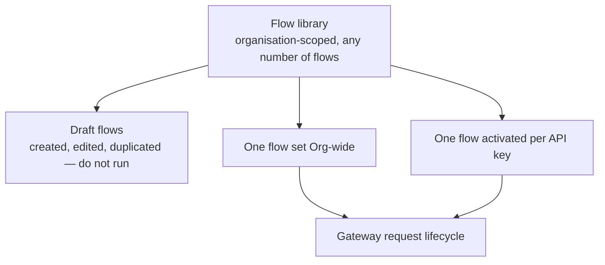

# Flow Studio

Flow Studio is a visual and YAML automation builder for the same lifecycle moments plugins use. Instead of writing a custom plugin for conditional logic, routing, or multi-step integrations, build a **flow**: a node graph of conditions, branches, loops, and actions that runs in the gateway request path.

Flows sit beside the plugin engine, not in place of it. A flow can call an activated marketplace or built-in plugin, and flows are ordered with plugin lanes through [Execution Lanes](/docs/plugins/execution-lanes).

## The Library Model

Flows live in an organisation-level **flow library**. Create, duplicate, edit, and delete any number of flows. None run until activated.

- **Organisation-wide** — exactly one flow can be the active organisation flow at a time. It runs for every API key in the organisation that does not override it.
- **Per API key** — each API key can independently activate one flow from the library on its own **Automation** tab. A single library flow can be activated on many keys at once.

This separates authoring from rollout: build in the library, then activate organisation-wide or pilot on one key.

## Why Use A Flow Instead Of A Plugin

| Need | Best fit |
| --- | --- |
| One clear, reusable, deployment-specific behavior (export to a SIEM, call one integration) | [Plugin](/docs/plugins) |
| Conditional logic: "if the model is X and the caller is not tier Y, then…" | Flow |
| Multi-step behavior: check a condition, call an external service, then branch again | Flow |
| Routing decisions based on request content, headers, or metadata | Flow |
| Looping over parts of a request (for example, each message) | Flow |
| Combining several plugins and custom logic into one visible, ordered pipeline | Flow |
| Behavior your security or platform team needs to review as source code, not a canvas | Plugin ([Request A Custom Plugin](/docs/plugins/request-custom-plugin)) |

Flows and plugins can work together. Use `Run Plugin` to invoke an already activated plugin, then let the flow decide when it runs and with which data.

## Where

| Location | Who | What |
| --- | --- | --- |
| `/{organisation}/plugins/flow` → **Flow Studio** tab | All org roles view; ORG_ADMIN edits | The flow library: create, duplicate, delete flows, and switch the organisation-wide active flow. The legacy ordered board remains available as **Plugin board**. |
| API key detail page → **Automation** tab | Key owner per RBAC (admins any key, managers their team/own keys, users their own keys) | Activate one library flow for that key, or clear the activation. |

## The Four Lifecycle Phases

A flow document can hold four graphs, one per lifecycle phase. It runs only in phases where the canvas has nodes beyond the starting point.

| Phase | Runs | What the graph can still do |
| --- | --- | --- |
| Pre-route | Before model routing, budget, and safety checks | Rewrite the request body, change the target model, set metadata or headers, or block |
| Pre-upstream | Immediately before the provider or MCP call | Last edits before the request leaves Odock |
| Post-upstream | After the provider or MCP response, before the reply reaches the caller | Rewrite the response body, status, or headers |
| Post-response | After the reply has already been sent (async by default) | Audit, notify, or bridge to another system — it cannot change what the caller received |

For how these four phases relate to plugin lifecycle moments and lanes, see [Flow Studio: Execution Order](/docs/plugins/flow-studio/execution-order).

## Section Guide

- [Building Blocks](/docs/plugins/flow-studio/building-blocks): the node categories available in the canvas, and the safety limits every flow runs under.
- [Execution Order](/docs/plugins/flow-studio/execution-order): how a flow's graphs combine with plugin lanes and other flows at the same phase.
- [Tutorials](/docs/plugins/flow-studio/tutorials): step-by-step guides to building, activating, and reading a flow.
- [Testing & Verification](/docs/plugins/flow-studio/testing-and-verification): how to validate a flow before saving it, and how to confirm it behaved as expected in production.
