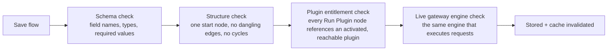

# Testing & Verification

A flow runs in the live request path. Flow Studio validates it before it can affect traffic and records evidence afterward.

## What Runs On Every Save

| Check | Catches |
| --- | --- |
| Schema | Missing required fields, wrong types, unknown node types |
| Structure | More than one start node, an edge pointing to a node that does not exist, a cycle outside of a Loop's body |
| Plugin entitlement | A **Run Plugin** node referencing a plugin your organisation has not activated, or that a key flow is not allowed to invoke |
| Gateway engine | Anything the first three checks miss, validated by running the document through the same engine that executes live requests |

If the gateway engine check is unreachable during save, the save still succeeds. The confirmation says the check was skipped, not failed. Re-open and re-save once the gateway is reachable.

## Test Scenarios To Run Before Wider Rollout

<Steps>

<Step>
Test the condition matching your intended change.

Send a request matching the traffic the flow should affect. Confirm the expected outcome: routed model, blocked request, transformed response, or other result.
</Step>

<Step>
Test the condition **not** matching.

Send a request that should fall through untouched. This confirms the flow does not affect unrelated traffic.
</Step>

<Step>
Test the failure path of any external call.

If the flow uses **HTTP Request**, point it at an unreachable or temporary URL. Confirm the `error` output and `on_error` behavior.
</Step>

<Step>
Test an intentional abort, if the flow can block.

Confirm the caller receives the status and message you configured, not a generic error.
</Step>

<Step>
For a post-response graph, confirm it never affects the reply.

The response should reach the caller unchanged while the post-response graph runs in the background. That lane cannot alter or delay an already sent response. See [Execution Lanes](/docs/plugins/execution-lanes).
</Step>

<Step>
Read the trace for each test request.

Use [Debug a flow run](/docs/plugins/flow-studio/tutorials/debug-a-flow-run) to confirm expected nodes ran in order.
</Step>

</Steps>

## Rollout Strategy

| Stage | How |
| --- | --- |
| Build | Edit in the library. Drafts do not run. |
| Pilot | Activate on one API key's **Automation** tab. Run the scenarios above on that key only. |
| Confirm | Review usage records, flow trace, and, if available, [Traffic Analytics: Plugins](/docs/observability/traffic-analytics/explore-plugins). |
| Roll out | Switch **Org-wide** on once the pilot key's behavior matches expectations |
| Monitor | Keep watching traces and usage evidence after rollout. Org-wide traffic may include shapes you did not test. |

<Callout type="warn">
Deactivating a flow takes effect immediately, whether you clear a key activation or switch **Org-wide** off. If rollout misbehaves, turn it off first.
</Callout>

## Fail-Open Guarantee

If a saved flow becomes invalid, for example from a load-time data issue, the gateway skips it for the affected request. The issue is logged. A broken flow cannot take the gateway down or fail closed for unrelated traffic.

## Underlying Platform Test Coverage

The platform test suite also covers the flow engine before each release:

- graph execution correctness — branching, looping, parallel joins, and every node type's behavior, matched against expected outputs
- error handling policy — both `continue` and `block` behavior for node failures
- YAML and canvas document round-tripping, so a flow you export and re-import behaves identically
- layering order — confirming flows always run after plugin lanes within the same layer, and that the five layers combine in the documented order
- fail-open behavior for invalid or unreachable documents

Your tests confirm your flow logic. Platform tests confirm the engine behaves consistently across releases.
