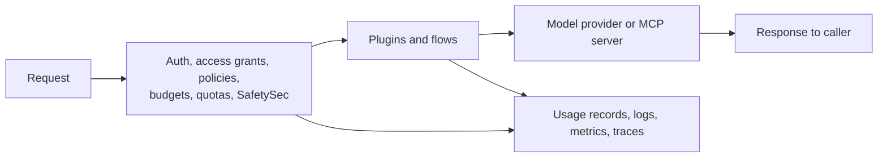

# Plugins

A plugin is a unit of code that runs at a point in the gateway request lifecycle. It can inspect a request or response, block it, transform it, call an external system, or record evidence. Plugins let an Odock deployment add behavior that is specific to one organisation, tenant, or workflow, without changing how applications call the gateway.

A flow is the second way to add that behavior: a node graph you build yourself in [Flow Studio](/docs/plugins/flow-studio) — conditions, branches, loops, and actions — instead of code. Plugins and flows run at the same lifecycle moments and are ordered together; this section covers both, starting with plugins.

## Plugins Vs. Flows

| | Plugin | Flow |
| --- | --- | --- |
| Built by | Odock, or requested from Odock for custom work | You, in Flow Studio |
| Logic | Fixed behavior with configuration values | A graph you design: conditions, branches, loops |
| Where you get one | The [Marketplace](/docs/plugins/marketplace) catalog, or a [custom request](/docs/plugins/request-custom-plugin) | Built from scratch or a template |
| Good for | One clear, reusable job — audit export, a webhook, a DLP integration | Conditional logic, multi-step routing, combining several checks into one pipeline |

A flow can call an already-activated plugin as one of its steps, so the two are not exclusive: use a plugin for the reusable, audited unit of work, and a flow to decide when and how it runs.

## What A Plugin Can Do

A plugin runs at one or more lifecycle moments and can:

- allow the request to continue unchanged
- block the request with a user-visible reason
- transform request or response fields
- add metadata or headers
- call an external system: a webhook, an approval system, a DLP or SIEM integration
- emit audit, analytics, or operational evidence
- run follow-up work after the response has already been sent

A plugin runs only where it has the data it needs. A plugin that reads the response cannot run before the response exists.

## Where Plugins Run

| Location | Scope | Who |
| --- | --- | --- |
| Deployment configuration | Every request | Set by the Odock deployment, always on |
| `/{organisation}/plugins/flow` → **Plugin board** tab | Every API key in the organisation | ORG_ADMIN edits; other roles view |
| `/{organisation}/plugins/flow` → **Flow Studio** tab | Every API key in the organisation, or one key | ORG_ADMIN edits; other roles view |
| API key detail → **Plugins** section | One API key | Key owner per RBAC |

These four sources are combined into one execution order per request — see [Architecture](/docs/plugins/architecture) for how, and [Execution Lanes](/docs/plugins/execution-lanes) for the sequential/parallel/async model they share.

## When To Use What

| Need | Use |
| --- | --- |
| Export request decisions to a SIEM or audit archive | Plugin |
| Add tenant metadata or a custom header before upstream work | Plugin |
| Send a webhook or email after a response | Plugin |
| Branch on request content, route by tier, or chain conditional steps | [Flow Studio](/docs/plugins/flow-studio) |
| Enforce requests per minute, payload size, or concurrency | Guardrail policy or ratelimit module |
| Detect prompt injection, unsafe output, or leakage | [SafetySec](/docs/security-and-guardrails/safetysec-engine) |
| Decide whether an API key can call a model or MCP server | Access grant |
| Stop spend or usage after a period limit | Budget or quota |

## How Plugins Differ From Other Controls

| Control | Primary question | Typical owner |
| --- | --- | --- |
| Access grants | Can this API key call this model or MCP server? | ORG_ADMIN |
| Guardrail policies | Does this traffic satisfy configured runtime limits? | ORG_ADMIN |
| SafetySec modules | Is the prompt or response safe? | ORG_ADMIN |
| Budgets and quotas | Would this exceed a spend or usage boundary? | ORG_ADMIN or finance |
| Plugins and flows | Does this deployment need custom workflow, integration, transformation, or evidence? | ORG_ADMIN, with Odock for custom code |

For the broader security model, start with [Security & Guardrails](/docs/security-and-guardrails). For MCP-specific tool risk, see [MCP Security](/docs/models-and-mcp/mcp-servers/security).

## Design Principles

| Principle | Meaning |
| --- | --- |
| Modularity | A plugin solves one problem and is replaceable without changing application code. |
| Least privilege | A plugin receives only the lifecycle moments, capabilities, and data it needs. |
| Lifecycle placement | A plugin runs where its required context exists, not earlier. |
| Composability | Several plugins and a flow can contribute to the same request without becoming one large custom system. |
| Observability | Every plugin decision is visible: allow, block, transform, or record. |

## Section Guide

- [Architecture](/docs/plugins/architecture): lifecycle gates, the execution layers, capabilities, and observability.
- [Plugin Lifecycle](/docs/plugins/plugin-lifecycle): the four gateway phases — pre-route, pre-upstream, post-upstream, post-response — and what a plugin can do at each.
- [Execution Lanes](/docs/plugins/execution-lanes): sequential, parallel, and async ordering within one lifecycle moment.
- [Flow Studio](/docs/plugins/flow-studio): the visual and YAML flow builder.
- [Marketplace](/docs/plugins/marketplace): browse, activate, and configure catalog plugins.
- [Plugin Board](/docs/plugins/plugin-board): the organisation-wide ordered pipeline.
- [API Key Plugin Chain](/docs/plugins/api-key-plugin-chain): plugins bound to one API key.
- [Evaluate A Plugin](/docs/plugins/evaluate-plugin): checklist for deciding whether to enable a plugin.
- [Request A Custom Plugin](/docs/plugins/request-custom-plugin): process for requesting a plugin that is not in the catalog.
- [Tutorials](/docs/plugins/tutorials): step-by-step walkthroughs.
