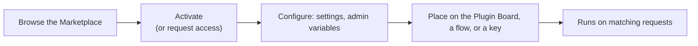

# Marketplace

The Marketplace is the catalog of plugins available to your organisation. Open it at `/{organisation}/plugins`.

Every role can browse the Marketplace. Activating, configuring, and binding a plugin to a key requires the matching RBAC action — see the table on each step below.

{/* GIF: Marketplace grid — cards with images, tier badges, and filters (/gifs/plugins-marketplace-grid.gif) */}

## Browsing

The grid shows one card per plugin: name, description, category, and tier. Filter by:

- category — security, transform, audit, integration, analytics, partner, or general
- tier — see [Tiers](#tiers) below
- lifecycle stage the plugin runs at
- activated — plugins your organisation has already turned on

## Tiers

A plugin's tier decides how you get access to it.

| Tier | Activation |
| --- | --- |
| Free / Community | Activate directly, no approval needed. |
| Paid (one-time) or Subscription | Activating starts the request; the plugin stays locked — no configuration, no board placement, no key binding — until payment is confirmed. |
| Premium | Invite-only. If your organisation does not have access, the card shows **Request access** instead of **Activate**. |

## Activating A Plugin

<Steps>

<Step>
Open `/{organisation}/plugins` and find the plugin.
</Step>

<Step>
Click **Activate**.

Free and Community plugins activate immediately. Paid and Subscription plugins move to a pending state until payment is confirmed — you will see this on the card. Premium plugins without an access grant show **Request access** instead; click it and wait for approval.
</Step>

<Step>
Open the plugin's profile to configure it — see [Plugin Profile](#plugin-profile) below.
</Step>

</Steps>

RBAC: activating, deactivating, and configuring a plugin requires ORG_ADMIN.

## Plugin Profile

Click a card to open the plugin's profile at `/{organisation}/plugins/{pluginId}`.

| Section | What it does |
| --- | --- |
| Configuration | The plugin's organisation-wide settings. |
| Admin Variables | Secret values the plugin needs (tokens, webhook signing secrets), encrypted in your browser before they reach Odock — see [Architecture](/docs/plugins/architecture#configuration-and-admin-variables). |
| Access | Grant which teams or users can bind this plugin to their own API keys, and whether a key can bind it again on top of the organisation board or flow (**allow keys to reuse this plugin**). |
| Keys | The API keys currently bound to this plugin. |

Enable, disable, or deactivate the plugin from the same page. A plugin awaiting payment confirmation only allows deactivation — every other action is locked until payment clears.

{/* GIF: Plugin profile — configuration, Admin Variables, Access, and Keys tabs (/gifs/plugins-profile-tabs.gif) */}

## Putting A Plugin To Work

Activating a plugin makes it available. It does not run yet. To make it run, place it on the [Plugin Board](/docs/plugins/plugin-board) or a [Flow](/docs/plugins/flow-studio) for the whole organisation, or bind it to a specific key on the [API Key Plugin Chain](/docs/plugins/api-key-plugin-chain).

## When The Catalog Doesn't Have What You Need

Not every requirement fits an existing catalog plugin. For anything custom, see [Request A Custom Plugin](/docs/plugins/request-custom-plugin).
