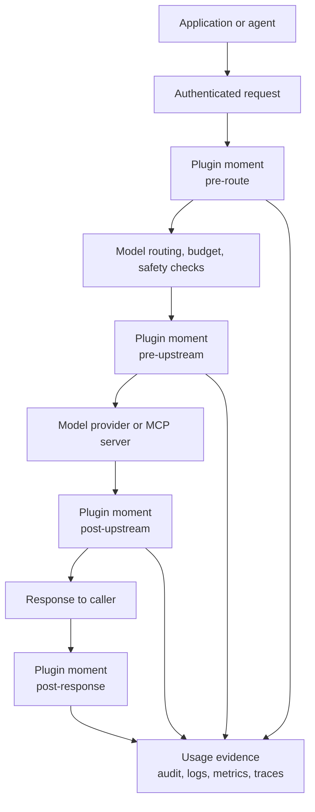
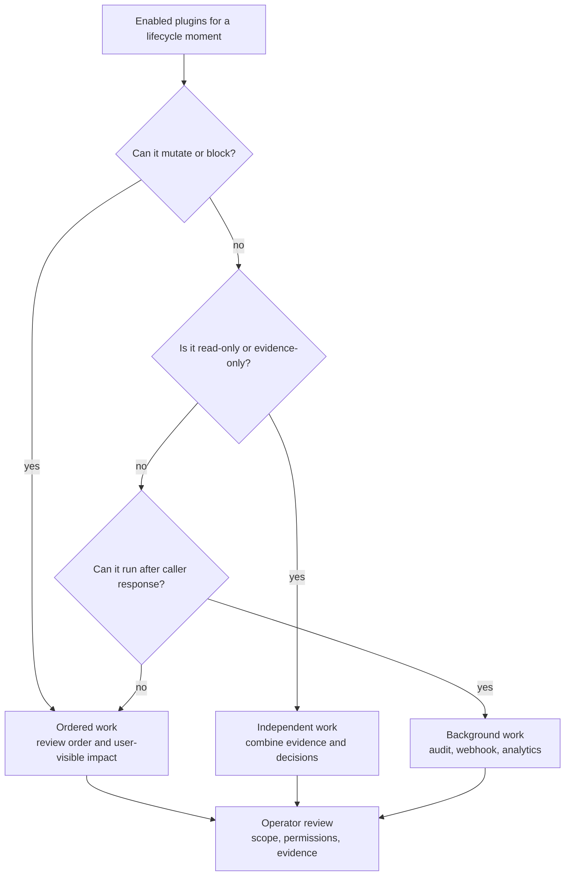
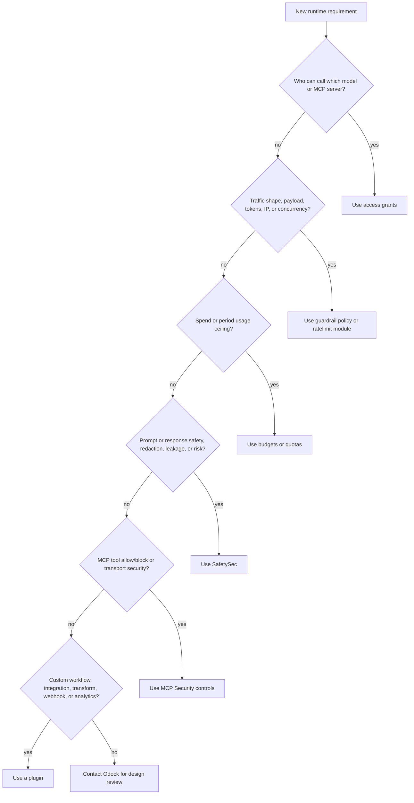

# Plugin Lifecycle

Plugins run at lifecycle moments where their required context exists. This page walks through each of the four moments, what a plugin can do there, and when to use it. These are the same four phases [Flow Studio](/docs/plugins/flow-studio) uses.

## Lifecycle Moments

Your deployment may add gateway work around these moments: authentication, access grants, policies, SafetySec, budgets, quotas, routing, usage recording, and reconciliation.

## Pre-Route

Use this moment when a plugin must act before the gateway decides routing, budget, or safety — the earliest point a plugin can run.

Common examples:

- change which model or MCP server handles the request
- tier-based routing decisions
- eligibility checks that should block before any cost is committed
- early metadata or headers other plugins will read later

Possible outcomes:

- allow the request unchanged
- change the target model
- add metadata or headers
- block with a user-visible reason
- emit request-side evidence

Do not place response-dependent plugins here. The response does not exist yet.

## Pre-Upstream

Use this moment for the last edits before the request leaves Odock — after routing, budget, and safety checks have already run.

Common examples:

- request enrichment with tenant, project, billing, or trace metadata
- custom headers for approved upstream integrations
- proprietary DLP checks before egress
- custom approval workflow before sensitive model use
- route-specific webhook calls that must complete before upstream work

Possible outcomes:

- allow the request unchanged
- add metadata or headers
- transform approved request fields
- block with a user-visible reason
- emit request-side evidence

Do not place response-dependent plugins here. The response does not exist yet.

## Post-Upstream

Use this moment when the plugin needs the provider or MCP response before acting.

Common examples:

- response DLP or classification integration
- response metadata enrichment
- post-response policy evidence before the caller sees the response
- custom response transformation for a specific tenant or tool
- analytics signals that depend on output status or content

Possible outcomes:

- allow the response unchanged
- transform approved response fields
- block or replace the response when configured to enforce
- emit response-aware evidence

Use [SafetySec](/docs/security-and-guardrails/safetysec-engine) instead of a plugin for prompt safety, response safety, redaction, leakage prevention, or repeated-risk behavior.

## Post-Response

Use this moment for work that should not delay the caller and cannot change the result — the reply has already been sent.

Common examples:

- audit export
- SIEM forwarding
- webhook delivery
- email notifications
- analytics warehouse export
- request id correlation
- post-response recommendation signals
- detection of special words or business events for reporting

Use it for background recording, export, or analysis. Do not use it for enforcement that should stop a request.

## Ordered, Independent, And Background Work

Use ordered work when a plugin may change state, transform content, or stop the request. Use independent work for observation and evidence that do not depend on other plugins. Use background work for audit export, webhooks, email, or analytics.

Ask: can this plugin change what the caller receives, or only record and export evidence?

For lane mechanics, including how plugins and active flows are ordered together, see [Execution Lanes](/docs/plugins/execution-lanes).

## Decision Tree

## Evidence Expectations

A plugin should leave evidence for:

- request id
- plugin name or display name
- lifecycle moment used
- action taken
- user-visible result, if any
- scope: organisation, team, API key, model, MCP server, or tenant
- external system called, if applicable
- whether the plugin changed request or response data
- whether the plugin ran in the response path or background

For catalog plugins, see [Marketplace](/docs/plugins/marketplace). For a plugin the catalog does not have, see [Request A Custom Plugin](/docs/plugins/request-custom-plugin). For conditional, multi-step behavior across these same moments without a custom plugin, see [Flow Studio](/docs/plugins/flow-studio).
