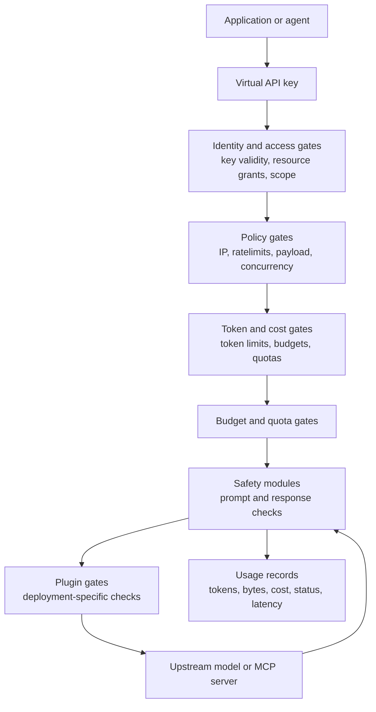

# Security & Guardrails

Security in Odock is layered. A request continues only when caller identity, resource access, policies, safety checks, cost controls, and plugin gates all allow it.

This section is for organisation users who configure and operate Odock resources. It explains runtime behavior without server internals.

## What This Section Covers

- **Guardrails**: policy scopes, inheritance, request limits, token limits, IP rules, MCP tool rules, budgets, quotas, and plugin gates.
- **Security Engine**: SafetySec phases, modules, session scoring, redaction, blocking, and response checks.
- **Security Console**: the organisation dashboard for live events, threat actors, the blocklist, and per-organisation policy.
- **Tutorials**: UI-driven steps for configuring organisation, API key, model, and MCP guardrails, plus how to verify enforcement in usage records.

For virtual API keys, see [Virtual API Keys](/docs/management/virtual-api-keys). For model access and MCP access, see [Models & MCP](/docs/models-and-mcp). For budgets and quotas, see [Budgets](/docs/management/budgets) and [Quotas](/docs/management/quotas).

## Runtime Security Model

Odock guardrails are:

- Request-aware: source, key, resource, payload size, and policy envelope.
- Token-aware: output size, token budgets, token-rate limits, pricing, quotas, and usage attribution.
- Content-aware: prompt and response text, sensitive data, unsafe instructions, leakage risk, and custom checks.

Apply the right guardrail at the right moment. Some gates run before expensive work. Some need API key, organisation, model, MCP server, or token context. Some need prompt or response text. Odock separates these concerns so policies stay explainable and decisions stay consistent across models and tools.

## Where Guardrails Come From

Configure guardrails at these layers:

| Layer | Typical purpose | Where users see it |
| --- | --- | --- |
| Organisation policies | Default network and traffic envelope for an organisation. | Organisation Settings, Policies card |
| API key policies | Tight limits for one application, agent, or workflow. | API key detail, Policies card |
| Model policies | Resource-specific caps for a model. | Model detail, Policies card |
| MCP policies and governance | Tool access, semantic filters, payload/rate limits, transport security. | MCP server detail cards |
| Access grants | Decide whether an API key can call a model or MCP server at all. | API key detail, Model Access and MCP Access |
| Budgets and quotas | Cost and usage ceilings for live traffic. | API key detail, Budgets and Quotas |
| Security engine | Prompt/response safety, redaction, leakage checks, and repeated-risk awareness. | Runtime behavior and usage/audit evidence |
| Plugins | Custom checks or transformations injected at lifecycle gates. | Runtime behavior configured by your Odock deployment |

## Recommended Reading Order

1. [Guardrails](/docs/security-and-guardrails/guardrails): understand policy scopes, runtime gates, modules, and plugins.
2. [Policy inheritance](/docs/security-and-guardrails/guardrails/policy-inheritance): learn how inherited limits combine.
3. [Runtime enforcement](/docs/security-and-guardrails/guardrails/runtime-enforcement): see when each gate runs.
4. [Security Engine](/docs/security-and-guardrails/safetysec-engine): understand SafetySec and its modules.
5. [Security Console](/docs/security-and-guardrails/safetysec-engine/security-console): watch SafetySec decisions live, manage the blocklist, and tune per-organisation policy.
6. [Tutorials](/docs/security-and-guardrails/tutorials): configure guardrails from the organisation UI.
