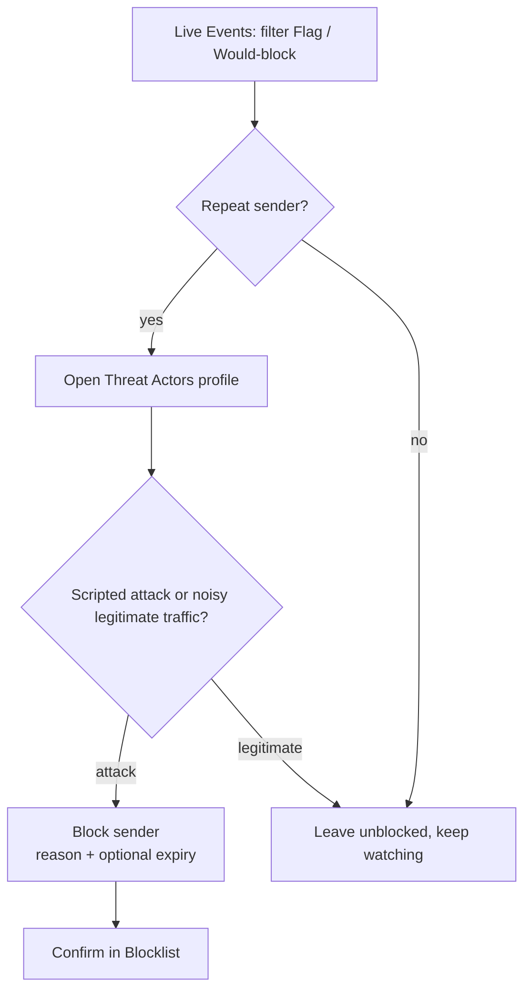

# Blocklist & Threat Actors

A block stops a sender before request work starts. Odock checks blocks immediately after authentication, before routing, upstream calls, or cost.

## What A Block Matches On

A block carries up to three selectors:

| Selector | Matches |
| --- | --- |
| Fingerprint | A stable identifier derived from the sender's request characteristics |
| API key | A specific virtual API key |
| IP address | A specific source IP |

A request is blocked when **any** non-empty selector on an active block matches. Blocks are organisation-scoped and affect only your organisation traffic.

## Manual Blocks

Create manual blocks from **Blocklist → Add block** or the **Block** action on a Live Event or Threat Actor row. Add a reason and optional expiry. Blocks and unblocks take effect immediately.

## Automatic Blocks

When a sender's cumulative session score crosses the organisation **auto-block score**, SafetySec creates a durable block labeled **Auto**. This happens only in **enforce** mode. Monitor mode never auto-blocks. See [Policy Configuration](/docs/security-and-guardrails/safetysec-engine/policy-configuration).

## Unblocking

Unblock from the **Blocklist** or from a **Threat Actor**'s profile. Two options are offered:

| Action | Effect |
| --- | --- |
| Unblock only | Lifts the block. If the sender's score is still above the auto-block threshold, an automatic block can re-fire on their next flagged request. |
| Unblock & reset threat score | Lifts the block and clears the sender's rolling session score, so an automatic block does not immediately re-trigger. |

Use score reset for confirmed false positives. Use unblock-only when you still want to watch the sender.

## Threat Actors: Reading A Profile

The Threat Actors tab groups signals by sender fingerprint, so repeated behavior appears as one row instead of scattered events. A profile includes:

- total events, blocks, and redactions for that sender
- current session score
- a radar of peak severity by module (which kind of risk this sender trips most)
- a breakdown of reasons and actions
- an activity timeline
- the most recent evidence entries

Use the profile to distinguish scripted attacks from noisy legitimate traffic before blocking.

## Investigation Workflow

For the full walkthrough, see [Investigate and block a suspicious sender](/docs/security-and-guardrails/tutorials/investigate-and-block-a-sender).
