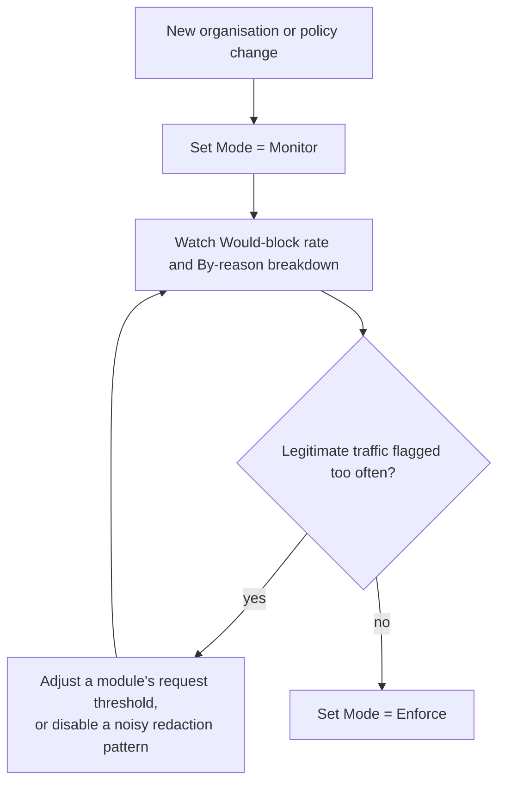

# Policy Configuration

Each organisation has its own SafetySec policy. Organisation Admins edit it in [Security Console](/docs/security-and-guardrails/safetysec-engine/security-console) → **Configuration**.

## Mode: Enforce Or Monitor

| Mode | Behavior |
| --- | --- |
| **Enforce** | A decision that would block a request actually blocks it. |
| **Monitor** | Nothing is blocked. Every decision that would have blocked is recorded as **Would-block** instead, visible in Overview and Live Events. |

Use Monitor mode to roll out a new organisation or policy change. It shows what *would* happen without blocking live traffic. See [Roll out SafetySec with monitor mode](/docs/security-and-guardrails/tutorials/roll-out-safetysec-monitoring).

## Thresholds

| Setting | Controls |
| --- | --- |
| Session block threshold | The cumulative session score at which a sender's behavior is blocked (in enforce mode) or flagged as would-block (in monitor mode). |
| Auto-block score | The cumulative session score at which the engine places a durable automatic block on its own. Set to disable to turn off auto-blocking for this organisation. |

Session scores accumulate across recent requests. One borderline finding rarely triggers action; repeated suspicious behavior can. See [Blocklist & Threat Actors](/docs/security-and-guardrails/safetysec-engine/blocklist-and-threat-actors) for auto-block behavior.

## Per-Module Tuning

Tune each module independently: prompt injection, jailbreak patterns, sensitive redaction, and data leakage.

| Control | Effect |
| --- | --- |
| Enabled | Turn the module off entirely for this organisation. |
| Request block threshold | How confident a single request's finding must be before it blocks on its own, independent of session history. |
| Redact requests / responses | Toggle which direction sensitive redaction applies to. |
| Redact on leak / Block on leak | For data leakage, whether a detected leak is redacted, blocks the response, or both. |
| Disabled redaction patterns | Turn off individual sensitive-value patterns (for example, disable the phone-number pattern for a product that legitimately handles phone numbers). |

## Choosing Thresholds

<Callout type="tip">
Tune one module at a time, then observe again. Session thresholds and module thresholds interact: changing a module threshold changes finding volume and session-score accumulation.
</Callout>

## Where Configuration Applies

A policy applies to one organisation only. It changes how aggressively modules act for that organisation; it does not change which modules exist.

## Continue With

- [Roll out SafetySec with monitor mode](/docs/security-and-guardrails/tutorials/roll-out-safetysec-monitoring)
- [Blocklist & Threat Actors](/docs/security-and-guardrails/safetysec-engine/blocklist-and-threat-actors)
- [Security Modules](/docs/security-and-guardrails/safetysec-engine/modules) for what each module family detects.
