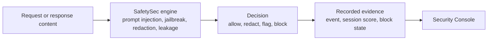

# Security Console

The Security Console shows SafetySec decisions operators can investigate and act on. It records every signal, redaction, and block, live and searchable, scoped by role.

## Where

Open **Security** in your organisation (`/{organisation}/security`). Organisation Admins can access it. MANAGER and USER roles cannot.

## The Five Tabs

| Tab | What it answers |
| --- | --- |
| **Overview** | How much safety activity happened, and when? Stat tiles (total events, blocked, would-block, redacted, unique actors, active blocks), an activity timeline with Daily/Weekly navigation, a calendar heatmap, and breakdowns by module and by reason. |
| **Live Events** | What just happened? A realtime feed of individual signals, redactions, and blocks, filterable by module and action, refreshing automatically while live updates are on. |
| **Threat Actors** | Who keeps triggering findings? A per-sender rollup (by fingerprint) of event counts, blocks, redactions, and current risk score, with a detail profile per actor. |
| **Blocklist** | Who is currently blocked, and why? Every active and historical block, searchable, with add/unblock actions. |
| **Configuration** | How strict is this organisation? Enforce vs. monitor mode, thresholds, per-module toggles, and which redaction patterns are active. |

A time-range selector (1h / 24h / 7d / 30d) scopes every tab. The Live toggle pauses the realtime feed without losing your place.

## Overview

Stat tiles summarize the selected window: total events, blocked, would-block, redacted, unique actors, and active blocks.

The activity timeline switches between **By type** and **Total**, and can step by day or week. The calendar heatmap shows activity by day and hour, useful for spotting scheduled attacks versus spread-out traffic.

## Live Events

Each row is one signal, redaction, or block decision with module, action, and severity. Filter, search, page results, open the API key, or block the sender directly.

## Threat Actors

Threat Actors groups events **per sender** by stable fingerprint. Repeated behavior appears as a pattern instead of scattered rows. Each actor shows event count, block/redaction history, and current session score.

Open a **threat profile** to see peak severity by module, reasons, actions, timeline, and recent evidence. Use it to decide whether to block, watch, or ignore.

## Blocklist And Configuration

See [Blocklist & Threat Actors](/docs/security-and-guardrails/safetysec-engine/blocklist-and-threat-actors) for how blocks work, and [Policy Configuration](/docs/security-and-guardrails/safetysec-engine/policy-configuration) for enforce/monitor mode and thresholds.

## Role Scope

| Role | Can do |
| --- | --- |
| ORG_ADMIN | View their organisation's events and actors, block or unblock senders, edit their organisation's policy |
| MANAGER / USER | No access to the Security page |

All events and blocks are scoped to your organisation.

## Continue With

- [Blocklist & Threat Actors](/docs/security-and-guardrails/safetysec-engine/blocklist-and-threat-actors)
- [Policy Configuration](/docs/security-and-guardrails/safetysec-engine/policy-configuration)
- [Roll out SafetySec with monitor mode](/docs/security-and-guardrails/tutorials/roll-out-safetysec-monitoring)
- [Investigate and block a suspicious sender](/docs/security-and-guardrails/tutorials/investigate-and-block-a-sender)
