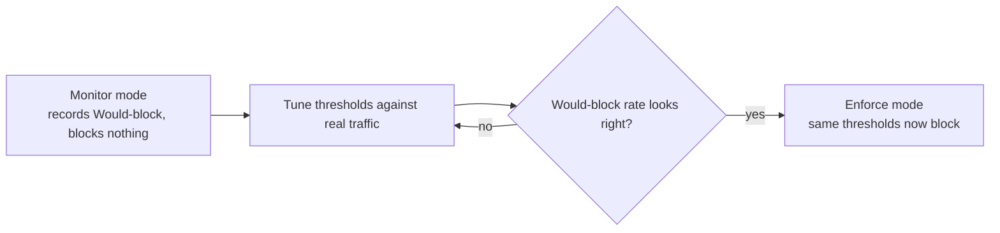

# Roll Out SafetySec With Monitor Mode

Use this when enabling SafetySec for an organisation or changing thresholds for an enforcing organisation. Monitor mode records what *would* happen without blocking real requests.

<Steps>

<Step>
Open the organisation's **Security → Configuration** tab.
</Step>

<Step>
Set **Mode = Monitor** and save.

Nothing is blocked. Decisions that would have blocked are recorded as **Would-block**.
</Step>

<Step>
Let real traffic run for a representative period. Start with a day.

In **Overview**, watch the **Would-block** tile and the **By reason** breakdown build up.
</Step>

<Step>
Review what would have blocked.

Open **Live Events** and filter action = **Would-block**. For each reason, decide whether it is real risk or legitimate traffic, such as support content with phone numbers or a workflow that only resembles a jailbreak.
</Step>

<Step>
Tune anything that looks like a false positive.

In **Configuration**, adjust the offending module's request-block threshold or disable a noisy redaction pattern. Save and observe one change at a time.
</Step>

<Step>
Switch to enforcement once the would-block rate matches your expectations.

Set **Mode = Enforce** and save. Decisions that meet thresholds now block requests.
</Step>

</Steps>

## Why Monitor Mode First

Enforce mode can block legitimate traffic before you know how the engine sees normal usage. Monitor mode removes that risk while you calibrate.

<Callout type="warn">
Auto-blocking never fires in monitor mode. If you tune the auto-block score, watch the Blocklist closely after switching to enforce.
</Callout>

## Next

- [Investigate and block a suspicious sender](/docs/security-and-guardrails/tutorials/investigate-and-block-a-sender)
- [Policy Configuration](/docs/security-and-guardrails/safetysec-engine/policy-configuration) for the full list of tunable settings.
